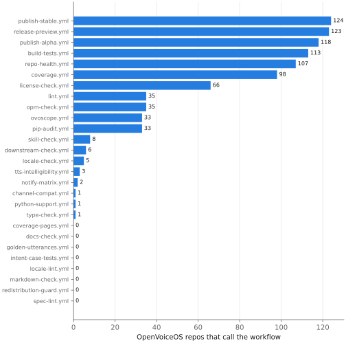

# gh-automations

<!-- agent-hint: catalog of reusable workflows and the rules for a change to them. Inputs and defaults: workflow-reference.md. verify: pytest test/ -->

`gh-automations` gives each OpenVoiceOS repo the same CI checks and the same release automation through reusable GitHub Actions workflows.

## Callers per workflow

<picture>
  <source media="(prefers-color-scheme: dark)" srcset="img/callers-dark.svg">
  
</picture>

`img/count_callers.py` writes `img/callers.csv` from a GitHub code search over the OpenVoiceOS organization. `img/plot_callers.py` makes this figure from `img/callers.csv`. Code search indexes the default branch of each repo only and returns at most 1000 files, so each count is a lower bound.

## Quickstart

A caller repo adds one small workflow file for each check. This file runs the build and test matrix on each pull request to `dev`:

```yaml
name: Build Tests
on:
  pull_request:
    branches: [dev]
jobs:
  build_tests:
    uses: OpenVoiceOS/gh-automations/.github/workflows/build-tests.yml@dev
    secrets: inherit
```

Each reusable workflow checks out this repo at run time to get `scripts/`. The ref of that checkout comes from the `gh_automations_ref` input, with the default `dev`. A caller that tests a branch of this repo sets both the `@<ref>` in `uses:` and `gh_automations_ref` to that branch.

## Pages

| Page | Read it to |
|---|---|
| [release-flow.md](release-flow.md) | Understand the alpha and stable release lifecycle and the `version.py` block |
| [workflow-reference.md](workflow-reference.md) | Find the inputs, defaults, jobs and outputs of each workflow |
| [license-whitelist.md](license-whitelist.md) | See which flagged packages the license check accepts, and why |
| [repo-setup.md](repo-setup.md) | Add the workflow files to a new repo |
| [repos.md](repos.md) | See which repos call these workflows |
| [maintenance.md](maintenance.md) | Change this repo safely, and see open technical debt |

## Workflow catalog

| Workflow | Use it to | Typical caller |
|---|---|---|
| `publish-alpha.yml` | Bump the version on a merge to `dev`, publish an alpha, open a release PR | Every package |
| `publish-stable.yml` | Remove the alpha number on a merge to `master`, tag the release | Every package |
| `release-preview.yml` | Predict the next version from the PR labels and title | Every package |
| `build-tests.yml` | Build, install and test the package on each Python version | Every package |
| `repo-health.yml` | Check the required files and the version block | Every package |
| `license-check.yml` | Fail on a dependency with a copyleft or unknown license | Every package |
| `pip-audit.yml` | Report dependencies with known vulnerabilities | Packages |
| `lint.yml` | Run ruff, pre-commit and actionlint | Packages |
| `type-check.yml` | Run mypy | Packages with type hints |
| `coverage.yml` | Run pytest with coverage, optionally deploy the HTML report to Pages | Packages |
| `channel-compat.yml` | Test against the constraints file of a release channel | Packages |
| `downstream-check.yml` | List the packages that depend on this package | Core libraries |
| `docs-check.yml` | Check that the required docs files exist, optionally run markdownlint | Any repo |
| `markdown-check.yml` | Run markdownlint and a lychee link check as blocking gates | Markdown-only repos |
| `opm-check.yml` | Find the plugin through OPM, check its interface and import time | Plugin repos |
| `tts-intelligibility.yml` | Score a TTS plugin by an STT round trip and a WER gate | TTS plugin repos |
| `redistribution-guard.yml` | Fail when a built artifact carries a library that the license whitelist accepts only when not redistributed | Image and wheel builds |
| `skill-check.yml` | Check locale coverage and `skill.json` | Skill repos |
| `spec-lint.yml` | Validate `locale/` against OVOS-INTENT-1 and OVOS-INTENT-2 | Skill repos |
| `locale-lint.yml` | Run the spec lint and the project locale policy on changed locale files | Skill repos |
| `locale-check.yml` | Check that the locale folder is in the built package | Skill repos |
| `ovoscope.yml` | Run the ovoscope end-to-end skill tests | Skill repos |
| `intent-case-tests.yml` | Measure intent-routing accuracy per language from case files | Skill repos |
| `golden-utterances.yml` | Run the golden-utterance rows of a skill | Skill repos |
| `notify-matrix.yml` | Send a message to the OVOS Matrix room | Release workflows |
| `coverage-pages.yml` | Deprecated: use `coverage.yml` with `deploy_pages: true` | Legacy callers |
| `python-support.yml` | Deprecated: use `build-tests.yml` | Legacy callers |

The workflows `test.yml` and `self-check-*.yml` run on this repo only. They are not reusable.

## For agents

Pick the workflow by the task:

- A new package: copy the file set from [repo-setup.md](repo-setup.md). Do not write CI steps by hand.
- A release problem: read `publish-alpha.yml` and `publish-stable.yml` in [release-flow.md](release-flow.md). Never edit `version.py` by hand; the workflows change it.
- A skill: use `skill-check.yml`, `locale-lint.yml`, `ovoscope.yml` and `golden-utterances.yml`.
- A plugin: use `opm-check.yml`. For a TTS plugin, add `tts-intelligibility.yml`.

The inputs that matter most:

- `gh_automations_ref` (default `dev`): the ref of the scripts checkout. It must match the ref in `uses:`.
- `uv_prerelease` (default `allow`): OVOS packages depend on alphas, so keep the default.
- `install_extras`, `system_deps`, `pre_install_pip`: what the test environment installs.
- `pr_comment` (default `true`): each check writes its own section of one shared PR comment.
- `publish_pypi` (default `false` in both publish workflows): a caller must set it to `true` to upload to PyPI.
- `warn_only`, `fail_on_errors`, `fail_on_missing`: they decide if a check blocks the PR. `pip-audit.yml` has `warn_only: true` by default; `license-check.yml` has `warn_only: false`.

Safety rules for a change to a workflow in this repo:

1. Never use a `secrets.*` value in an `if:` condition. GitHub rejects the workflow file. Copy the secret into a job `env:` value and test the env value.
2. Never put an input or an event field directly in `run:` text. Pass it through `env:` and use the shell variable, so that a value cannot inject shell commands.
3. `self-check-actionlint.yml` runs actionlint on each pull request and each push to `dev` that changes `.github/workflows/`. Run actionlint locally before you push.
4. Run `pytest test/`. The test suite parses each workflow and checks the scripts.
5. Update [workflow-reference.md](workflow-reference.md) when an input, a default or an output changes.

Agent-hint `verify` lines in these pages give a command that exits 0 when the page is still true.
